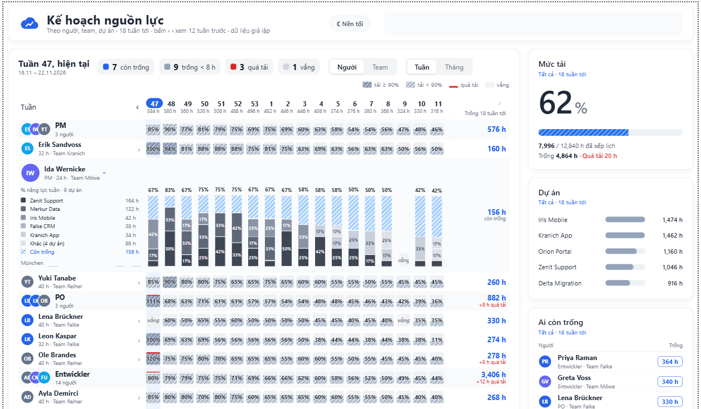
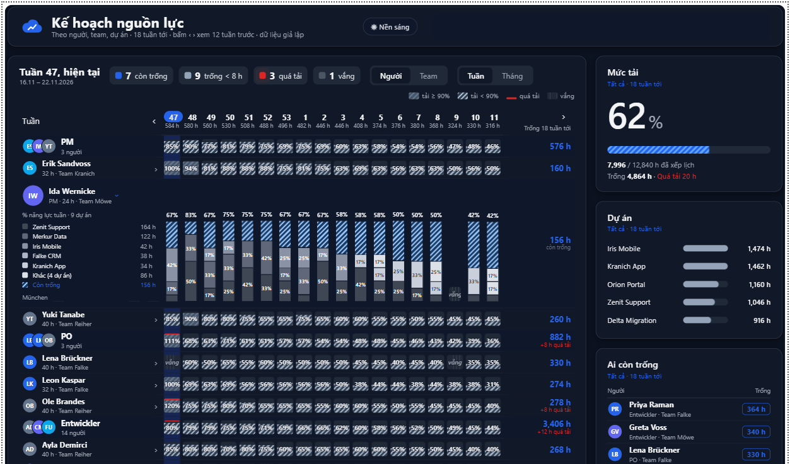
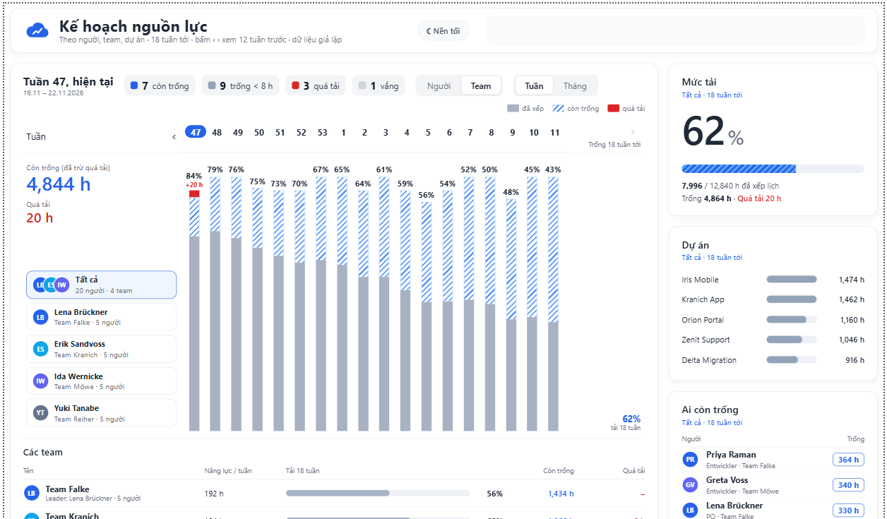
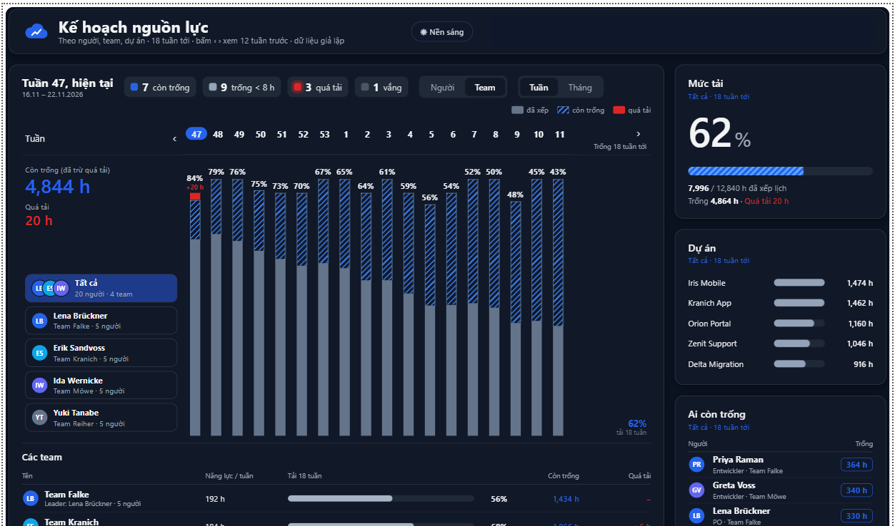
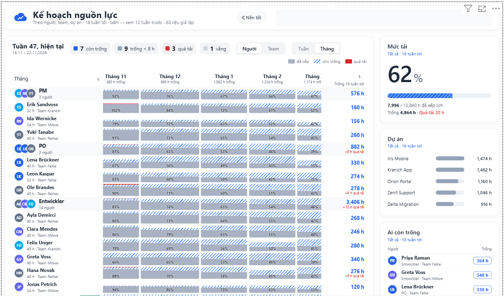
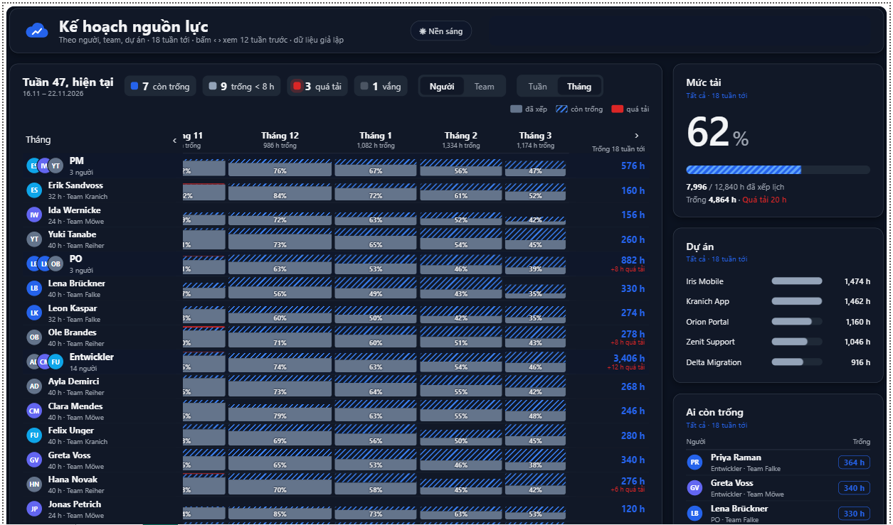
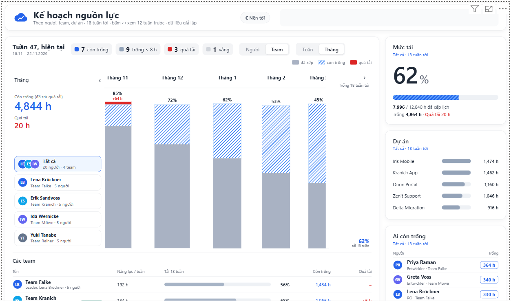
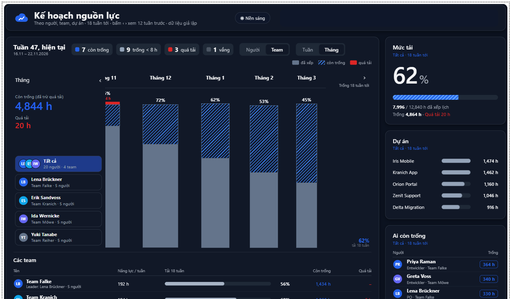
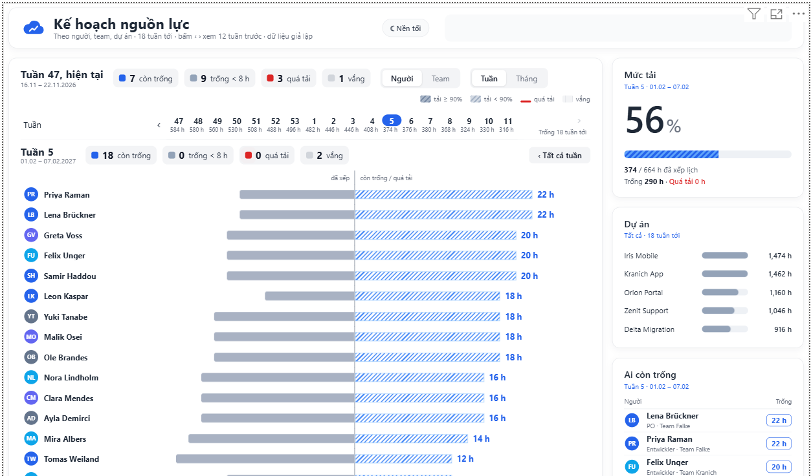
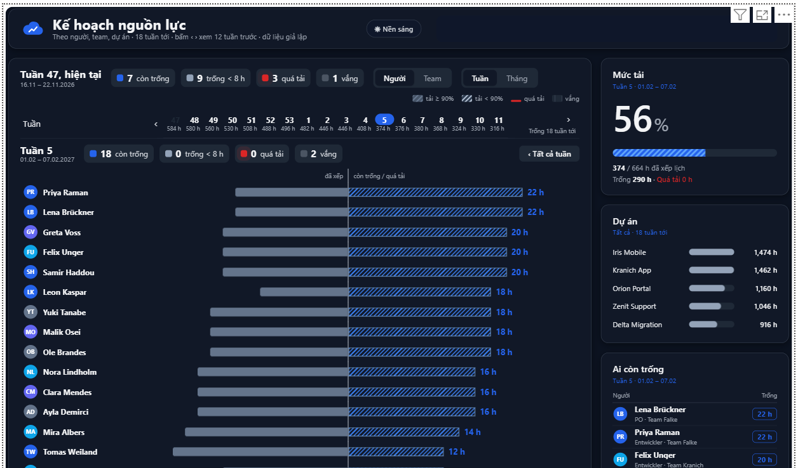

# Resource Planning Dashboard in Power BI

An interactive resource-planning page built in **Power BI** with a single **DAX measure** that renders HTML, CSS and SVG inside the *HTML Content* visual. Every click on the page (expanding rows, switching views, moving between weeks, dark mode) is pure CSS: the visual runs no JavaScript.

Built by **Daniel Dang** · Data Analyst (SQL · Power BI · DAX · Power Query)



## Screenshots

| Light mode | Dark mode |
|---|---|
|  |  |
|  |  |
|  |  |
|  |  |
|  |  |

## What the page does

The page answers the questions a staffing lead asks every week: *who has free hours, who is overbooked, and for how long?*

- **Workload heatmap:** people (grouped as PM / PO / Developers) × 18 weeks. Each cell shows utilisation as a hatched fill, a red edge for overbooking and a marker for absence. Totals on the right show free hours and overbooked hours for the next 18 weeks.
- **Click a name to expand the row:** a stacked column per week split by project, with % of weekly capacity, a red 100 % line and a pink background on overbooked weeks.
- **People ⇄ Team toggle:** the team view shows total planned, free and overbooked hours per week. Clicking a team-leader card switches the chart to that team and lists its members with utilisation bars.
- **Week ⇄ Month toggle:** months are drawn wider or narrower according to how many weeks they contain.
- **‹ › arrows:** the page always opens on the current week, and the arrows step back up to 12 weeks to check past overload.
- **Click a week or a month header:** opens a diverging bar chart for that period (planned hours left of the axis, free or overbooked hours right of it, including how many weeks in a row a person has been overbooked). The *Utilisation* and *Who is free* cards on the right switch to the same week or month. Click the header again to go back.
- **Dark mode** button, KPI cards (utilisation, top projects, people with the most free hours) and tooltips on every cell.

## How it works

| Part | Approach |
|---|---|
| Rendering | One DAX measure builds the whole page as an HTML string for the **HTML Content** visual |
| Interactivity without JavaScript | Hidden `<input type="radio">` / checkboxes + `<label for>` + CSS `:checked ~` selectors (row expand, view toggles, week/month detail, team selection, dark mode) |
| Week navigation | CSS custom properties (`--off`, `--wk`) and `transform: translateX`, with the name and total columns counter-shifted so they stay in place |
| Column widths | Container query units (`cqw`) so exactly 18 weeks fit the visual at any size |
| Performance | All numbers come from one person × week table (`ADDCOLUMNS` + `CROSSJOIN`), computed once and reused by every chart, tooltip and card |
| Dark theme | Generated from the light CSS by mapping light backgrounds to dark and dark text to light, then fine-tuned by hand |

## Data model (synthetic data)

All names, projects and customers are invented. The generator is tuned to produce realistic patterns: about 65 % utilisation over the next 16 weeks, a few people overbooked in the current week, plans thinning out further ahead, and occasional absences.

| Table | Grain | Rows |
|---|---|---|
| `fact_allocation` | person × project × week (planned hours) | 1,070 |
| `fact_capacity` | person × week (capacity, absence) | 760 |
| `dim_person` | person (role, team, location, weekly capacity) | 20 |
| `dim_project` | project (customer, lead team, dates, budget) | 10 |
| `dim_team` | team | 4 |
| `dim_date` | day, with ISO week columns | 266 |

Relationships: both fact tables → `dim_date[Date]` and `dim_person[Person_ID]`; `fact_allocation` → `dim_project`; `dim_person` → `dim_team`.

## Repository

```
dax/html_resource_planning.dax   the HTML measure (paste as a new measure)
dax/base_measures.dax            base measures: hours, utilisation, free / overbooked hours, counts
data/                            sample data: Excel workbook + one CSV per table
scripts/                         Python that generates the sample data (spec + weekly facts)
docs/data_spec.md                data specification and generation rules (Vietnamese)
images/                          screenshots
```

## Run it yourself

1. Power BI Desktop → **Get data → Excel** → `data/resource_planning_sample.xlsx`, load all sheets.
2. Create the relationships listed above and mark `dim_date` as the date table.
3. Create an empty table `_measure` and add the measures from `dax/base_measures.dax`.
4. Add a disconnected table (used to pre-open rows, optional):
   `Person_Pick = DISTINCT ( SELECTCOLUMNS ( dim_person, "Name", dim_person[Name] ) )`
5. New measure → paste `dax/html_resource_planning.dax`, then put it in an **HTML Content** visual (about 2480 × 1560 px on a 2560 px wide page).

To regenerate the data: `python scripts/make_sample_from_spec.py scripts/resource_planning.spec.json --out out` then `python scripts/build_weekly_facts.py out` (needs pandas, numpy, openpyxl).
